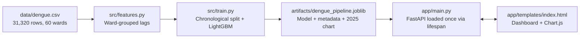

# Architecture — Urban Dengue Outbreak Early-Warning System

## 1. System Overview

The system separates offline model training (`src/train.py`) from local web serving (`app/main.py`). Both stages import the same feature pipeline from `src/features.py` so live predictions use the exact same lag math as training.

**Core endpoints (`app/main.py`):**
- `GET /` — Renders the dashboard with ward options and 2025 test metrics.
- `GET /api/ward/{ward_id}` — Returns static ward info and recent weather defaults from memory.
- `GET /api/validation-chart` — Returns precomputed 2025 weekly actual vs. predicted totals.
- `POST /api/predict` — Builds a 5-week window (4 prior weeks + target week), runs `build_features()`, predicts weekly cases, maps the risk tier, and returns the top 5 feature drivers via `pred_contrib=True`.

---

## 2. Feature Engineering (`src/features.py`)

Because *Aedes aegypti* mosquitoes take roughly 2 to 4 weeks from heavy rain to adult transmission and reported cases, all weather lags are computed strictly inside each ward (`sort_values(["ward_id", "date"]).groupby("ward_id")`) so data never leaks across neighborhoods.

- **Weather Lags (12 features):** 1-to-4-week lags of `rainfall_mm`, `avg_temp_c`, and `relative_humidity_pct`.
- **3-Week Rolling Stats (3 features):** Rolling sum of rainfall and rolling averages of temperature and humidity over weeks `t-3` to `t-1` (`shift(1).rolling(3)`).
- **Seasonality & Temp Spread (3 features):** Diurnal range (`max_temp_c - min_temp_c`) plus cyclical week-of-year (`week_sin`, `week_cos`).
- **Vulnerability Interactions (3 features):** 3-week lagged rainfall multiplied by `water_logging_risk_index`, `population_density_sqkm`, and `(1 - sanitation_score)`.
- **Ward & Current Weather Context (10 features):** Current weather inputs, static ward vulnerability metrics, and native categorical `city_cat` / `ward_cat`.

No lagged `dengue_cases` are used as inputs, so the model can forecast future weeks purely from weather and ward characteristics without needing recent hospital counts.

---

## 3. Validation Strategy & Model Selection

Random train/test splits leak future weeks into past weeks in time-series data. We used a strict chronological split across the 10-year dataset (`2016–2025`):

- **Train:** `2016-01-04` to `2023-12-25` (8 years)
- **Validation:** `2024-01-01` to `2024-12-30` (used to tune Tweedie power; `RMSE: 1.501`)
- **Blind Test:** `2025-01-06` to `2025-12-29` (refit on `2016–2024`, evaluated once)

### Model Benchmark (2024–2025 Chronological Holdout)

| Model | MAE | RMSE |
| :--- | :---: | :---: |
| **LightGBM (Tweedie)** | **0.789** | **1.535** |
| LightGBM (Poisson) | 0.817 | 1.564 |
| HistGradientBoosting | 0.843 | 1.577 |
| Random Forest | 0.866 | 1.622 |
| Ridge (Baseline) | 1.179 | 2.106 |

**Why LightGBM (Tweedie, `power=1.3`) won:**
- **Zero-inflated target:** `58.0%` of weekly rows have `0` dengue cases while monsoon peaks hit `41`. Tweedie loss (`1 < p < 2`) handles exact zeros and right-skewed spikes better than standard MSE or pure Poisson.
- **Built-in explainability:** `model.predict(X, pred_contrib=True)` returns exact per-prediction feature contributions in milliseconds without extra libraries.
- **Fast & lightweight:** Runs on CPU with a ~1.8 MB artifact—unlike deep sequence models (LSTMs), which require heavy dependencies and are harder to explain to health officers.

### Final Blind 2025 Test Results
- **MAE:** `0.800` cases/ward/week
- **RMSE:** `1.546` cases/ward/week
- **R²:** `0.846`
- **4-Tier Risk Accuracy:** `84.2%` (`Low < 2`, `Medium 2–4.99`, `High 5–9.99`, `Critical >= 10`)

---

## 4. Efficiency & Reliability

- **Single-load startup:** FastAPI's `lifespan` loads `artifacts/dengue_pipeline.joblib` once into memory at boot. `/api/predict` never reads from disk or reloads the model.
- **Zero external API costs:** All inference and driver calculations run locally on CPU (`$0` per forecast) and keep working offline.
- **Precomputed lookups:** Ward metadata, 4-week history, and the 2025 chart series are bundled inside the `.joblib` file so dashboard endpoints respond from RAM without re-reading `data/dengue.csv`.
- **Input validation & fallback:** Pydantic validates temperature bounds (`min_temp_c <= max_temp_c`), non-negative rainfall, humidity (`0–100%`), and ISO dates (`422` on bad input, `404` on unknown ward). If the `.joblib` file is missing or incompatible on a new machine, startup automatically re-runs `train_and_export()` to rebuild it.
- **Phase 2 scaling note:** When adding live weather APIs later, forecasts should be cached per city (5 calls every 6–12 hours) rather than per ward (60 calls) or per page load.