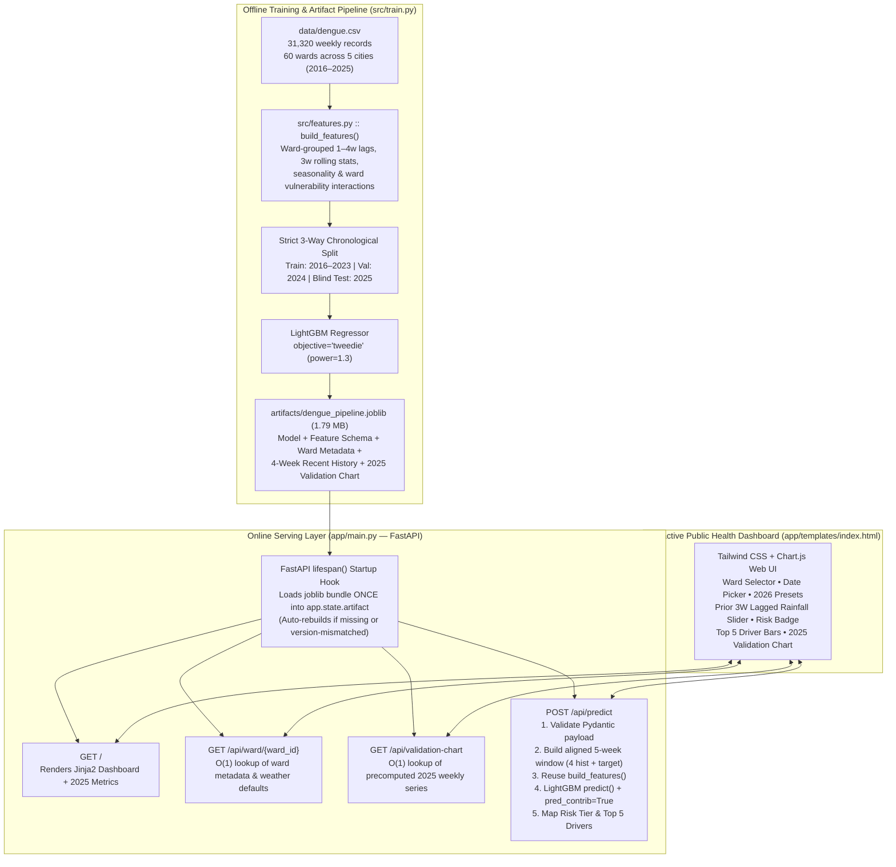

# System Architecture — Urban Dengue Outbreak Early-Warning System

This document describes the end-to-end data flow, chronological validation strategy, model selection rationale, compute/cost efficiency controls, and operational resilience of the **Urban Dengue Outbreak Early-Warning System** (EDU AI Engineering Hackathon 2026 — Phase 1).

---

## 1. System Data Flow Diagram

The architecture cleanly separates **offline chronological training** from **low-latency local online serving**, reusing the exact same feature pipeline (`src/features.py`) in both stages to eliminate training–serving skew.

---

## 2. Feature Engineering & Domain Alignment (`src/features.py`)

Dengue transmission is governed by the *Aedes aegypti* **vector breeding clock** (7–14 days for eggs in stagnant rainwater to mature + viral incubation and symptom onset = **2-to-4-week lag**) combined with **hyper-local urban vulnerability**.

To prevent cross-ward leakage, all temporal transformations are strictly computed **within each ward** using `df.sort_values(["ward_id", "date"]).groupby("ward_id")`:

| Feature Group | Engineered Columns (31 Total Features) | Epidemiological Justification |
| :--- | :--- | :--- |
| **Multi-Week Weather Lags** | `rainfall_lag_1w..4w`, `temp_lag_1w..4w`, `humidity_lag_1w..4w` | Captures the exact 1-to-4-week mosquito breeding, larval survival, and incubation lag window. |
| **3-Week Rolling Aggregates** | `rainfall_roll_3w` (sum), `temp_roll_3w` (mean), `humidity_roll_3w` (mean) | Measures sustained monsoon water accumulation and ambient conditions prior to the target week (`shift(1).rolling(3)` to prevent same-week leakage). |
| **Micro-Climate & Seasonality** | `temp_range_c` (`max - min`), `week_sin`, `week_cos` | Encodes diurnal temperature variation and smooth cyclical annual monsoon timing without tree-split discontinuities at year boundaries. |
| **Ward Vulnerability Interactions** | `rain_x_waterlogging_3w`, `rain_x_density_3w`, `rain_x_poor_sanitation_3w` | Quantifies why identical rainfall 3 weeks ago triggers severe outbreaks in poorly drained, densely crowded, low-sanitation wards while sparing resilient wards. |
| **Static Ward Context** | `population_density_sqkm`, `water_logging_risk_index`, `sanitation_score`, `city_cat`, `ward_cat` | Anchors baseline susceptibility per city and municipal ward using LightGBM's native categorical splits. |

**Zero Target Leakage:** No lagged `dengue_cases` columns are used as model inputs. This guarantees the model forecasts purely from weather + ward vulnerability and can project arbitrary future weeks without requiring prior hospital admission counts.

---

## 3. Chronological Validation Split (`src/train.py`)

Random train/test splits cause severe temporal leakage in epidemic time series (allowing trees to interpolate adjacent weeks from the same outbreak wave). We enforce a **strict 3-way chronological split**:

1. **Training Set (`2016-01-04` to `2023-12-31`):** 8 full years of multi-city seasonal cycles used to fit candidate models.
2. **Validation Set (`2024-01-01` to `2024-12-31`):** 1 full unseen year used to verify hyperparameter settings (`Validation RMSE: 1.501`).
3. **Blind Untouched Test Set (`2025-01-01` to `2025-12-29`):** Refit finalized hyperparameters on `2016–2024` and evaluate **once** on 52 unseen weeks across all 60 wards.

| Evaluation Metric (Blind 2025 Test Set) | Value | Operational Meaning |
| :--- | :---: | :--- |
| **MAE** | **`0.800` cases/ward/week** | Sub-1-case average weekly ward error across the entire year. |
| **RMSE** | **`1.546` cases/ward/week** | Strong peak-surge control during monsoon spikes. |
| **R²** | **`0.846`** | Explains 84.6% of weekly outbreak variance on an unseen year. |
| **4-Tier Risk Accuracy** | **`84.2%`** | Accurate operational classification into `Low` (`<2`), `Medium` (`2–4.99`), `High` (`5–9.99`), and `Critical` (`>=10`). |

---

## 4. Model Selection Rationale & Design Trade-Offs

### Selected Model: `LightGBM Regressor` (`objective="tweedie"`, `tweedie_variance_power=1.3`)

- **Matches Zero-Inflated Outbreak Distribution:** In `data/dengue.csv`, **58.0%** of weekly ward records have `0` dengue cases, while peak monsoon weeks spike up to `41` cases. Standard MSE/L2 loss under-predicts surges and outputs negative counts. Tweedie regression (`1 < p < 2`, compound Poisson–Gamma) natively models exact zeros plus skewed positive count distributions.
- **Native Non-Linear Interactions & Explainability:** Gradient boosted decision trees naturally learn non-linear thresholds (e.g., rainfall × high humidity × water-logging risk) and expose fast exact TreeSHAP feature contributions via `model.predict(X_row, pred_contrib=True)` with zero external explanation libraries.

### Alternatives & Trade-Offs Considered

| Alternative | Why Not Selected for Phase 1 |
| :--- | :--- |
| **Linear / Poisson GLM** | Cannot easily capture non-linear temperature-humidity thresholds or complex ward-level interactions without manual polynomial expansion. |
| **LSTM / Deep Sequence Models** | Higher training/inference latency, heavier dependency footprint (PyTorch/TensorFlow > 1 GB), harder to explain per-feature weather drivers to public health officers, and typically underperforms GBDTs on structured tabular data of ~31k rows. |
| **External LLM Forecasting** | High latency (seconds per call), recurring token costs, non-deterministic numeric outputs, and risk of network/rate-limit outages during municipal emergencies. |

---

## 5. Compute, Caching & API Cost Efficiency

Designed for resource-constrained public health offices and scaled production deployment in Phase 2:

1. **Zero Runtime External API / LLM Token Cost (`$0.00` per forecast):**
   - All inference and feature attribution execute locally on CPU via the `1.79 MB` serialized bundle (`artifacts/dengue_pipeline.joblib`), avoiding paid API loops and external latency entirely.
2. **Single-Load In-Memory Caching (`FastAPI lifespan`):**
   - `dengue_pipeline.joblib` is deserialized **exactly once** at server startup into `app.state.artifact`. Prediction endpoints never touch disk or reload models, achieving single-digit millisecond local inference.
3. **Precomputed Static & Validation Payloads:**
   - Static `ward_metadata`, 4-week `recent_history`, and the 52-week `weekly_test_chart` are aggregated once during training and bundled inside the artifact. `GET /api/ward/{ward_id}` and `GET /api/validation-chart` serve directly from RAM in `O(1)` time without re-reading the `2.58 MB` CSV or re-running inference.
4. **Phase 2 External Weather API & Optional LLM Cost Controls:**
   - When expanding in Phase 2 to live meteorological APIs (e.g., Open-Meteo / BMD) or optional LLM-generated briefing summaries:
     - **City-Level Weather Caching (TTL 6–12 hours):** Query weather APIs per city (5 calls) rather than per ward (60 calls) or per user click, reducing external API volume by **>90%**.
     - **Strict Prompt & Token Budgeting:** If an LLM narrative layer is added, keep numerical forecasting strictly in LightGBM, pass only the compact Top 5 driver JSON (<150 input tokens), cap output at `<= 120` tokens, and cache advisories by `(ward_id, risk_tier, week)` so repeated dashboard views incur zero additional tokens.

---

## 6. Resilience & Error Handling

- **Strict Request Validation:** `PredictRequest` (Pydantic v2) enforces numeric sanity bounds on temperatures, non-negative rainfall, humidity (`0–100%`), ISO `YYYY-MM-DD` date parsing, and physical consistency (`min_temp_c <= max_temp_c`), returning clear `422` responses on invalid inputs and `404` on unknown ward IDs.
- **Cross-Environment Artifact Self-Healing:** On startup, if `artifacts/dengue_pipeline.joblib` is missing or fails deserialization due to a local Python/NumPy/scikit-learn version difference on a judge's machine, `lifespan()` automatically invokes `train_and_export()` (~3–5 seconds) to rebuild a compatible bundle before serving traffic.
- **Network Failure & Rate-Limit Immunity:** Because core inference has zero external API dependencies, network interruptions or third-party rate limits never halt outbreak risk forecasting. On the frontend, failed fetch calls are caught and surfaced in a non-blocking inline error banner while preserving user inputs.
